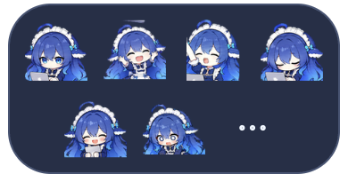

# deepseek——大肥鱼桌宠

一只抱着电脑办公、会甩尾和庆祝的蓝发鲸鱼女仆。独立运行，支持 Windows 与 Mac，不需要安装 ChatGPT，也不需要 API Key。

**[下载最新版本](https://github.com/1281788994-dev/dafeiyu-desktop/releases/latest)** · **[完整使用说明](github-source-upload/docs/使用说明.md)**

## 下载和运行

| 电脑 | 下载文件 | 运行方式 |
| --- | --- | --- |
| Windows 10 / 11，64 位 | 大肥鱼桌宠-Windows-x64-v1.1.2.zip | 完整解压，运行大肥鱼桌宠.exe，保留旁边运行文件 |
| Mac，Apple 芯片 | 大肥鱼桌宠-Mac-Apple芯片-v1.1.2.zip | 解压，把 App 拖进应用程序后打开 |
| Mac，Intel 芯片 | 大肥鱼桌宠-Mac-Intel-v1.1.2.zip | 解压，把 App 拖进应用程序后打开 |

当前为测试版：Apple 芯片 Mac 已启动验证，Windows 与 Intel Mac 尚未实机验证。发行包尚无正式发布者签名 / Apple 公证，首次打开可能出现系统安全提示。请确认下载来源，不需要关闭系统安全保护。

## 六个动作

以下为实际动画素材的静态分镜，从左到右表示动作顺序。

### 抱电脑甩尾
鼠标碰到她，尾巴就摆起来。


### 抛、跳、接、工作
双击她：抛起电脑、跳起来、接住，再坐回去工作。


### 伸个懒腰
“伸个懒腰，脑洞就打开啦。”


### 抱电脑打盹
“我只是闭眼整理一下思路。”


### 抱电脑站起跳
“电脑抱稳，快乐起飞。”


### 电脑事故小剧场
“完了……修好就当没发生。”


## 互动和设置



- 鼠标移到角色上显示工具栏，六个头像分别触发六种动作。
- 按住角色拖动，位置自动保存；右键打开设置菜单。
- 可调节速度、大小、置顶、减少动画和隐藏；气泡位于人物上方。
- 内置 18 句本地文案，闲时偶尔做小动作，可在菜单中关闭。
- 专注计时支持 5 / 25 / 45 分钟，到时自动庆祝。
- 菜单栏 / 系统托盘图标可显示、隐藏或退出桌宠。

不联网，不收集使用数据，不自动设置开机启动。本项目提供本地文字气泡，不包含 AI 聊天或语音对话，不读取其他应用任务状态。

## 开发

源码在 [github-source-upload](github-source-upload/) 目录，使用 Electron 45.1.0。进入该目录后：

```sh
node --test tests/animation.test.js tests/renderer.test.js
electron app
```

运行需要安装 Node.js 和 Electron；下载发行包的普通用户无需安装开发环境。精灵表为 1536×2704 透明 PNG，共 13 行，每格 192×208。打包方式见[完整项目说明](github-source-upload/README.md)。

## 来源与许可

角色参考：[1190fasheqi/dafeiyu-pet](https://github.com/1190fasheqi/dafeiyu-pet)。使用用户提供参考后制作的二创动画，不代表 DeepSeek、Apple 或 OpenAI 官方。代码采用 [MIT License](github-source-upload/LICENSE)，角色与图像权利不随代码许可改变，详见[素材说明](github-source-upload/NOTICE.txt)。
